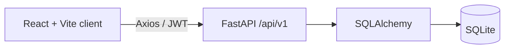
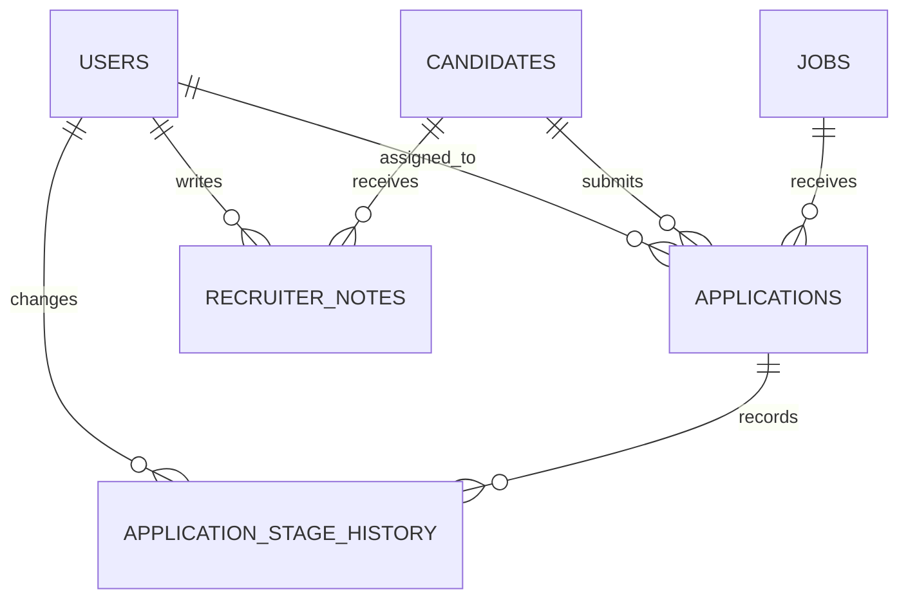

# Mini ATS — Applicant Tracking System

A full-stack internship assignment for managing a recruiter’s candidates, jobs, applications, notes, pipeline stages, and database-backed analytics. It uses React, Vite, Tailwind CSS, Axios, FastAPI, SQLAlchemy, SQLite, Pydantic, Recharts, JWT, Pytest, Vitest, and React Testing Library.

## Architecture



The API uses a strict recruiter-only access rule: every operational endpoint requires a valid JWT. The frontend stores the token locally for the development session and sends it in the Authorization header. Dashboard results are database aggregates, never fixture values.

## Data model



Candidates are profiles and applications are separate records, with a unique candidate/job pair. Deleting a candidate removes its applications, stage history, and notes. Jobs are closed instead of deleted. Skills use a documented comma-separated text field to keep the exercise small while allowing case-insensitive server-side filtering; a dedicated skills table is a natural later migration.

Stages are Applied → Screening → Interview → Offer → Hired, with rejection allowed before hire. Hired and Rejected are terminal. Every creation and permitted change records an immutable history record. “Total candidates” is distinct candidate profiles; all other stage metrics count applications, so multi-job candidates do not inflate the candidate metric. Conversion rate is hired applications divided by all applications.

## Run locally

Requirements: Python 3.10+ and Node 20+.

```powershell
cd backend
Copy-Item .env.example .env
python -m venv .venv
.\.venv\Scripts\Activate.ps1
pip install -r requirements.txt
python seed.py
uvicorn app.main:app --reload
```

In another terminal:

```powershell
cd frontend
Copy-Item .env.example .env
npm install
npm run dev
```

Open `http://localhost:5173`; Swagger is at `http://localhost:8000/docs`.

`seed.py` is repeatable and creates only fictional sample data. For the assignment demo, it creates `demo@miniats-demo.com` with password `DemoPass123!`; change or delete that account outside local development.

## Deploy (Vercel + Render)

The repository includes `render.yaml` for the FastAPI service and PostgreSQL database, and `frontend/vercel.json` for client-side route fallback.

1. Push the project to GitHub. In Render, create a Blueprint from that repository and review the resource plans before applying. The included blueprint uses free plans; Render free PostgreSQL databases are temporary and expire, so choose a paid persistent database if you need the demo data to survive beyond the free database term.
2. Wait for the Render API service to become healthy, then copy its public URL (for example, `https://mini-ats-api.onrender.com`).
3. In Vercel, import the repository and set the project root directory to `frontend`. Set `VITE_API_URL` to `https://<render-api-host>/api/v1`, without a trailing slash, then deploy.
4. Copy the deployed Vercel origin (for example, `https://mini-ats.vercel.app`) into the Render API service's `CORS_ORIGINS` environment variable, comma-separated with any other allowed origins. Redeploy the API after changing it.
5. Create the first recruiter account via the API's `/docs` page using `POST /api/v1/auth/register`. Do not run `seed.py` in production: it creates a publicly known demo password.

Set a strong, unique `JWT_SECRET` in the Render environment. Never commit `.env` files, database files, or credentials.

## API

| Area | Endpoints |
|---|---|
| Authentication | `POST /auth/register`, `POST /auth/login`, `GET /auth/me` |
| Candidates | `GET/POST /candidates`, `GET/PATCH/DELETE /candidates/{id}` |
| Jobs | `GET/POST /jobs`, `GET/PATCH /jobs/{id}`, `PATCH /jobs/{id}/close` |
| Applications | `GET/POST /applications`, `GET /applications/{id}`, `PATCH /applications/{id}/stage`, `GET /applications/{id}/history` |
| Notes | `GET/POST /candidates/{id}/notes` |
| Dashboard | `/dashboard/summary`, `stage-distribution`, `application-trends`, `recent-activity` |

All API routes are versioned beneath `/api/v1`. Candidate list supports `search`, `skills`, experience bounds, sort, order, page, and page size. Applications support stage, candidate, job, and date range filters.

## Tests and build

```powershell
cd backend; pytest
cd ..\frontend; npm test
npm run build
```

The backend tests use a separate `test_ats.db` database. Frontend Vitest/React Testing Library tests cover login, session validation, dashboard filter/error handling, and candidate filtering/error handling.

## Deployment and limitations

Use `docker compose up --build` for local containers. SQLite is selected for this assignment; production should use PostgreSQL by setting `DATABASE_URL` and running `alembic upgrade head`; the initial revision is in `backend/migrations/versions`. Put JWT secrets in a secret manager, configure HTTPS, and store resumes in authenticated object storage. This version validates resume URLs and intentionally does not accept files.

## Folder layout

```text
backend/app/{api,core,db,models,schemas}
backend/tests              API tests
frontend/src/{api,context,layouts,pages}
```
